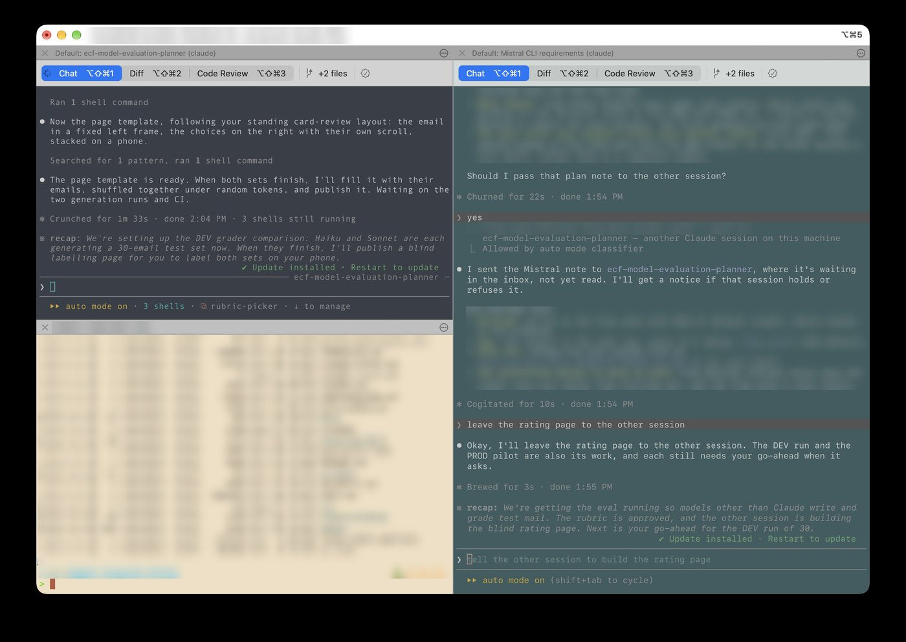

# About this repo

- Are you new to living in the terminal?
- Do you now find yourself running Claude Code, Codex or another AI agent in multiple tabs at once?
- Do you hate how limited Terminal's colors are?
- Are you bored with the iTerm2 defaults?

This gives every iTerm2 tab its own look, so you can tell them apart at a glance.

## What it does

- **Every new tab, window or split pane gets a random color scheme and font.** Light schemes when macOS is in Light Mode, dark ones in Dark Mode. Hard-to-read schemes are skipped.
- **You rate the ones you like** (1 to 5 stars). Rated looks come up more often.
- **Each rated look becomes a profile** under **Profiles → Favorites**, so you can open it on purpose, e.g. a "Kibble - Menlo" tab for your Claude Code session.

This toolkit only recolors iTerm2 sessions. Nothing about your shell, prompt or AI tools changes.

**See the Profile Chooser in Action**

Two Claude Code sessions and a plain shell in one window. Each pane got its own colors when it opened.



## Why it helps with AI agents

Agents work in long-running sessions, and it's easy to lose track of which tab is which:

| Default iTerm2 Color Scheme | With the Profile Manager Activated |
|---|---|
| Five black tabs, all running `claude` | Five different colors and fonts |
| Typing into the wrong agent's tab | The color tells you where you are before you type |
| Same look for "agent is working" and "my shell" | Open a favorite profile for agent work, let other tabs stay random |

Optional: `.tools/srcp_enable_claude_integration.py` turns on iTerm2's built-in Claude Code integration (status tracking for running `claude` sessions) from the command line. See the README.

## Before you start

You need a Mac with [iTerm2](https://iterm2.com), plus:

| Setting or tool | Where |
|---|---|
| Python API | iTerm2 → Settings → General → Magic → **Enable Python API** |
| Python runtime | iTerm2 → Scripts → Manage → **Install Python Runtime** |
| Theme follows Light/Dark Mode | iTerm2 → Settings → Appearance → Theme → **Automatic** |
| `git` and `python3` | Terminal: `xcode-select --install` (skip if already installed) |

## Install (about 5 minutes)

Setup edits iTerm2's settings, so iTerm2 must be closed while it runs.

1. Quit iTerm2 (⌘Q) and open **Terminal.app** (in Applications → Utilities).
2. Run:

   ```sh
   git clone https://github.com/rmarable/iterm2-profile-manager.git ~/src/iterm2-profile-manager
   cd ~/src/iterm2-profile-manager
   ./setup.sh --dryrun   # optional: see what it will do, changes nothing
   ./setup.sh
   ```

3. Open iTerm2. Every new tab now gets a new look.

Running `setup.sh` again is safe. It backs up iTerm2's settings before changing them.

## Daily use

| To | Do |
|---|---|
| Keep a look you like | Right-click → **Save/update this profile**, or press ⌃⌥⌘S, then pick 1 to 5 stars |
| Never see a scheme again | Same dialog → **Never show**. It's gone for good, with every font, and survives updates. |
| Open a saved look | **Profiles → Favorites → \<name\>** |
| See your ratings | **Scripts → srcp_ratings.py** |
| See schemes you've hidden | **Scripts → srcp_ratings.py** → **Hidden** |
| Bring a hidden scheme back | **Hidden** shows how; or rate it from a tab that still has it |

Changes apply to the next tab you open.

## Uninstall the toolkit

Quit iTerm2, then from Terminal.app:

```sh
cd ~/src/iterm2-profile-manager
./uninstall.sh --dryrun   # see what would be removed
./uninstall.sh            # turn it off; keeps your ratings and color schemes
./uninstall.sh --all      # remove everything setup.sh added
```

## Something's wrong?

| Symptom | Fix |
|---|---|
| Tabs don't change color | Check Scripts → Manage → Console for errors. Make sure the Python API is enabled. |
| Always light, or always dark | Set Settings → Appearance → Theme to Automatic. |
| Most tabs look like your default profile | Settings → Profiles → Colors → turn off "Use separate colors for light and dark mode". |
| `setup.sh` says iTerm2 is running | Quit it (⌘Q) and run from Terminal.app. |

Everything else (how schemes are picked, settings, backups, the database) is in [README.md](README.md).

**Tip:** if you use Claude Code or Codex, you can open it in this folder and ask it to explain or change anything here.
