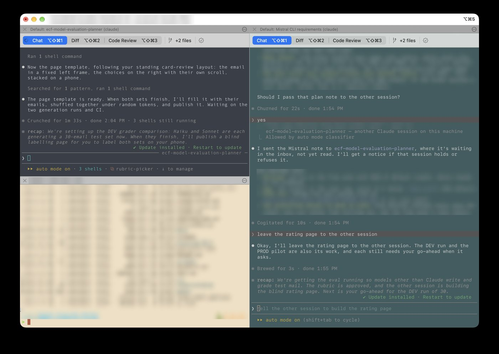

# iTerm2 Profile Manager

iTerm2 Profile Manager gives every new iTerm2 tab and window its own color scheme and fixed-width font, so you can tell your sessions apart at a glance. Rate the looks you like and they come up more often; hide the ones you don't.

The presets come from [iTerm2-Color-Schemes](https://github.com/mbadolato/iTerm2-Color-Schemes) (800+). Light presets are used when macOS is in Light Mode and dark ones in Dark Mode. Colors that are hard to see against their background are adjusted a little, so most presets are readable. (You can turn that off; see [docs/REFERENCE.md](docs/REFERENCE.md#color-adjustments).)

Press `⌃⌥⌘S` to rate the current preset and font from 1 to 5 stars. Rated combinations come up more often and are saved as profiles under **Profiles → Favorites**. To hide a preset until you bring it back, click **Never show** in the same dialog, or right-click → **Never show this profile**.



Only iTerm2's colors and fonts change. Your shell and prompt are left alone. Set up three things in iTerm2, then installation is a single script.

## Why it helps with AI agents

Agents run in long-lived sessions, and it's easy to lose track of which tab is which.

| Default iTerm2 Color Scheme | With the Profile Manager Activated |
|---|---|
| Five black tabs, all running `claude` | Five different colors and fonts |
| Typing into the wrong agent's tab | The color tells you where you are before you type |
| Same look for "agent is working" and "my shell" | Open a favorite profile for agent work, let other tabs stay random |

## Requirements

### Software

| Software | Notes |
|---|---|
| macOS | Required. `setup.sh` exits on other systems. |
| [iTerm2](https://iterm2.com) | Tested on 3.7.6. Install in `/Applications` or `~/Applications`, or set `ITERM_APP` to its path. |
| Xcode Command Line Tools | `xcode-select --install`. Provides `git` and `/usr/bin/python3` (3.9+). |
| [Homebrew](https://brew.sh) | Optional. Installs MesloLGS Nerd Font, which Oh My Zsh prompts need, and any [fonts you add](#adding-fonts). |

No pip packages are needed. Setup needs network access to clone the schemes repo.

### iTerm2 settings

Set these before running setup:

| Setting | Where | Why |
|---|---|---|
| Python API | Settings → General → Magic → **Enable Python API** | Scripts can't connect without it. |
| Python runtime | Scripts → Manage → **Install Python Runtime** | The main script runs on it (Python 3.12). |
| Theme | Settings → Appearance → Theme → **Regular**, **Minimal** or **Compact** | These follow the macOS light/dark mode; Light, Dark and the High Contrast themes don't. |

## Install

Setup changes iTerm2's settings, and iTerm2 overwrites them when it quits, so run it with iTerm2 closed.

1. Quit iTerm2 (`⌘Q`) and open **Terminal.app** (Applications → Utilities).
2. Run:

   ```sh
   git clone https://github.com/rmarable/iterm2-profile-manager.git ~/src/iterm2-profile-manager
   cd ~/src/iterm2-profile-manager
   ./setup.sh --dryrun   # optional: shows every step, changes nothing
   ./setup.sh
   ```

3. Open iTerm2. **Scripts → Manage → Console** should show `srcp_set_random_color_profile <version>`, then one line per new session, e.g. `[info] dark discovery: Nord | Menlo-Regular 13 (84 ms)`.

`setup.sh` is safe to re-run. It:

1. Copies SF Mono and SF Mono Terminal from Terminal.app into `~/Library/Fonts`. A different copy you already have there is left alone (delete it in Font Book and re-run to get Terminal.app's).
2. Installs MesloLGS Nerd Font via Homebrew, if installed, because Oh My Zsh prompts need it.
3. Clones or updates iTerm2-Color-Schemes in `~/src/iTerm2-Color-Schemes` (set `SRC_DIR` to use another folder). A folder there that isn't a clone of that repo is used as it is, not updated.
4. Imports its schemes as iTerm2 color presets, and updates ones the repo has changed since, unless you've edited them.
5. Builds the database the main script picks from.
6. Binds `⌃⌥⌘S` to the rating dialog.
7. Copies the scripts into iTerm2's Scripts folder (unless that folder is a clone of this repo), and removes older versions' AutoLaunch scripts.

It backs up iTerm2's settings to `~/.local/share/iterm2-profile-manager/prefs-backups/com.googlecode.iterm2-<timestamp>.plist` before changing them (newest 10 kept). For a custom `SRC_DIR`, cloning straight into the Scripts folder, or a manual install, see [docs/REFERENCE.md](docs/REFERENCE.md#install-options).

## Daily use

| To | Do |
|---|---|
| Keep a look you like | Right-click → **Save/update this profile**, or press `⌃⌥⌘S`, then pick 1 to 5 stars. Rate again to change. |
| Try a different look in this tab | Right-click → **Change to another profile**. Repeat until one sticks. |
| Open a saved look | **Profiles → Favorites → \<name\>** |
| Drop a favorite | Right-click → **Remove profile from favorites**, or in the rating dialog (`⌃⌥⌘S`) → **Remove favorite**. |
| Never see a scheme again | Right-click → **Never show this profile**, and the tab switches to another look. If it's a favorite, you're asked first, since its stars are deleted. Or in the rating dialog (`⌃⌥⌘S`) → **Never show**. Either way it's hidden with every font and stays hidden through updates. |
| See your ratings | **Scripts → srcp_ratings.py** |
| See schemes you've hidden | **Scripts → srcp_never_show.py** (or **srcp_ratings.py** → **Hidden**) |
| Bring a hidden scheme back | **Scripts → srcp_never_show.py**, pick it in the list, then **Show again**. Its old stars don't come back; rate it again if you want it as a favorite. |
| See the odds of the next look | In the repo: `python3 .tools/srcp_odds.py`. Bar charts of the chance of each favorite, a colored background, and each font. Changes nothing. |

Changes apply to the next session you open. Sessions opened from a favorite profile keep that look.

To change how often favorites come up or which schemes are allowed, see [Configuration](docs/REFERENCE.md#configuration). To add or remove fonts, see [Adding fonts](#adding-fonts).

## Adding fonts

New tabs get a random font from a pool of seven: SF Mono, SF Mono Terminal, Menlo, Monaco, PT Mono and Andale Mono, which come with macOS or Terminal.app, and MesloLGS Nerd Font Mono, which `setup.sh` installs with Homebrew, if you have it, because Oh My Zsh prompts need it.

No other Homebrew fonts are installed by default. To add one, run this in the repo:

```sh
python3 .tools/srcp_fonts.py --add "JetBrains Mono"
```

It installs the font with Homebrew if you don't have it yet, then adds it to the pool. New tabs can use it right away. `--help` lists the fonts it knows; `--remove` takes one out again; `--dryrun` shows what either would do.

To compare the fonts first, run `python3 .tools/srcp_fonts.py` on its own. It opens a page showing every fixed-width font on your Mac, and the ones you could add, side by side. The full list is in [docs/MONOSPACE-FONT-INVENTORY.md](docs/MONOSPACE-FONT-INVENTORY.md), and the details in [REFERENCE.md](docs/REFERENCE.md#fonts-tool).

## Update

Quit iTerm2, then from Terminal.app in the repo:

```sh
git pull
./setup.sh   # pulls the schemes repo, imports new and changed presets, rebuilds the database, copies the scripts
```

Relaunch iTerm2. If the repo is the Scripts folder, `git pull` alone updates the scripts: then run `python3 .tools/srcp_build_scheme_db.py` (an update may need a newer database; the Console says so) and restart the main script from the Scripts menu, or relaunch iTerm2.

## Uninstall

Quit iTerm2, then from Terminal.app in the repo:

```sh
./uninstall.sh --dryrun        # preview; safe with iTerm2 open
./uninstall.sh                 # remove the defaults below
./uninstall.sh --all           # also --data --presets --fonts --repo
```

| Item | Flag |
|---|---|
| Main script (renamed `.py.disabled` if the Scripts folder is a clone of this repo) | (default) |
| Menu scripts copied into the Scripts folder | (default) |
| Favorite profiles (iTerm2 drops its saved copies the next time it opens) | (default) |
| `⌃⌥⌘S` key binding (settings backed up first) | (default) |
| Database, snapshots, launch history (ratings exported to `~/srcp-curation-<time>.sql` first, with a copy of the whole database beside it; other files there, and snapshots dated in the future, are kept) | `--data` |
| Presets matching the repo's files, current or earlier versions (edited ones are kept) | `--presets` |
| The Terminal.app fonts `setup.sh` installed, while unchanged since, and the MesloLGS Homebrew package if it installed it (fonts you had already stay) | `--fonts` |
| iTerm2-Color-Schemes clone (kept if it has changes, commits, stashes, worktrees or ignored files of yours) | `--repo` |

Kept: this repo, iTerm2 settings backups, shell config, and the Claude Code integration (`python3 .tools/srcp_enable_claude_integration.py --remove` undoes that). Open sessions keep their colors until closed. Re-run `setup.sh` to reinstall.

## Troubleshooting

| Symptom | Cause and fix |
|---|---|
| Tabs don't change color | Check **Scripts → Manage → Console** for errors, and that the Python API is enabled. |
| Console: `[error] missing or outdated .../.tools/srcp_schema.py, srcp_db_backup.py or srcp_iterm_prefs.py (...); run ./setup.sh again` | The main script couldn't load its helpers from its `.tools/` folder (not copied, or left from an older version). Run `./setup.sh` again from Terminal.app with iTerm2 quit; if the repo is the Scripts folder, `git pull` (or `git checkout .tools` if the folder is gone) and restart the main script from the Scripts menu instead. |
| Console: `no scheme DB at ...` | Run `python3 .tools/srcp_build_scheme_db.py`. No restart needed. |
| Console: `preset not found: X` | Preset renamed or deleted in iTerm2. Run `python3 .tools/srcp_build_scheme_db.py`. |
| Console: `3 picks in a row weren't installed presets` | Same cause, for many presets at once (presets were removed). Run `python3 .tools/srcp_build_scheme_db.py`. |
| Console: `no dark presets to pick from; sessions left as is` (or `light`), or `nothing left to pick: ...` after right-click → **Change to another profile** or **Never show this profile** | Every preset of that mode is hidden or left out. Show some again with **Scripts → srcp_never_show.py**. |
| Console: `the scheme DB is schema N, older than this version reads ...` | The scripts were updated but the database wasn't rebuilt. Run `python3 .tools/srcp_build_scheme_db.py`; new tabs are colored again right away, no restart needed. |
| Console: `profile 'X' has "Use separate colors for light and dark mode" on ...` | That profile draws its own light and dark colors, so a preset wouldn't show; its tabs are left as is. To have them colored, turn the checkbox off in **Settings → Profiles → Colors** for that profile, then right-click → **Change to another profile** on tabs already open. Your favorites' profiles have it off already. |
| Console: `MesloLGSNFM-Regular isn't installed; icon font left as is` | Oh My Zsh prompt icons (Powerlevel10k and the like) need MesloLGS Nerd Font: `brew install --cask font-meslo-lg-nerd-font`, or turn the icon font off ([Configuration](docs/REFERENCE.md#configuration)). Tabs are colored either way. |
| Console: `favorite profiles not updated (tried again every 10 minutes): ...` | Reading iTerm2's settings failed or took over 30 s, so **Profiles → Favorites** wasn't refreshed. Tabs are still colored. The profiles are checked every 30 seconds; a failed write is tried again when your favorites change, or after 10 minutes. |
| Console: `coloring session ... took over 15 s and was given up; ...` | iTerm2 stopped answering while the tab was being colored (rare; a lost reply), or the database was busy. Other tabs carry on meanwhile. If the message says `nothing was changed`, the tab keeps its profile's look; if it says the tab `may show a new look that wasn't recorded`, re-roll it with right-click → **Change to another profile**. |
| Console: `... is damaged (...); restore a snapshot: docs/REFERENCE.md, Restore` | The database file is damaged. Quit iTerm2 and restore a snapshot: [Restore](docs/REFERENCE.md#restore) has the commands. If the build refuses that snapshot too, try the next older one. |
| Console: `favorite 'X' isn't an installed preset` | A favorite's preset was removed from iTerm2, so it's left out of **Profiles → Favorites**. Re-import it (`./setup.sh` for the repo's presets; open your own `.itermcolors` file again), or remove the favorite: `sqlite3 -cmd ".timeout 5000" ~/.local/share/iterm2-color-schemes/schemes.db "delete from favorites where preset = 'X'"` (picked up within 30 seconds). |
| Console: `X changed since the DB was built; its color adjustments are skipped` | You edited or re-imported the preset after the last build, so its colors show unadjusted. Run `python3 .tools/srcp_build_scheme_db.py`. No restart needed, unless you also updated the scripts: then restart the main script too. |
| Console: `the scheme DB is schema N, newer than this version reads ...` | The scripts were updated and the database rebuilt, but the main script running is still the old one. Restart it from the Scripts menu, or relaunch iTerm2. |
| A preset looks a little different from its screenshots | Colors that were hard to see are adjusted. To see the originals, turn that off: [docs/REFERENCE.md](docs/REFERENCE.md#color-adjustments). |
| Always light, or always dark | Settings → Appearance → Theme: **Regular**, **Minimal** or **Compact**, not Light, Dark or High Contrast. |
| Console: `another copy is still running after 5 s; exiting` | A lock allows one copy, and a restart waits 5 s for the old one to exit. If new tabs stopped changing color, a copy from before is stuck: quit iTerm2, run `pkill -f srcp_set_random_color_profile` in Terminal.app, and relaunch. |
| A font never appears | Disabled or not installed: `select name, enabled from fonts`, or `python3 .tools/srcp_fonts.py`. If you installed it after setup, run `python3 .tools/srcp_build_scheme_db.py`. No restart needed. |
| A favorite is missing from the Profiles menu | Preset not installed, or marked **Never show**. |
| `⌃⌥⌘S` does nothing | Check Settings → Keys → Key Bindings for `save_profile()`, and the Console for the main script's startup line. |
| Console: `[warn] DB pick_look: database is locked` (or another name after `DB`), then `couldn't read the DB; session left as is` | A rebuild or open `sqlite3` transaction held the lock over 5 s. A session opened then keeps the profile's colors, or isn't logged; a rating made then shows a "didn't take" alert: rate again. |
| `srcp_build_scheme_db.py`: `... schemes.db is locked (another sqlite3 session or a long write?)` | Another program has the database open, usually an `sqlite3` session in some tab. Close it and run the build again; the message says whether the database was changed. |
| `srcp_build_scheme_db.py`: `schemes.db is missing but its -wal/-shm files are still there` | Move `schemes.db-wal` and `schemes.db-shm` out of the way (keep them until the new build works), or restore a snapshot. |
| A tool says iTerm2 is running | Quit iTerm2 (`⌘Q`) and run the tool from Terminal.app. |
| Setup says iTerm2 loads its settings from a custom folder | iTerm2 would overwrite the changes. Turn off Settings → General → Settings → **Load settings from a custom folder or URL**, run setup, then turn it back on and save the current settings to the folder. |

## More

- [docs/REFERENCE.md](docs/REFERENCE.md): how a look is picked, [seeing the odds](docs/REFERENCE.md#see-the-odds), configuration, backups and restoring, exporting ratings, the Claude Code integration, the database, and development.
- [docs/ROADMAP.md](docs/ROADMAP.md): what's planned next.
- [DISCLAIMER.md](DISCLAIMER.md): what this changes on your Mac.
- If you use Claude Code or Codex, open it in this repo and ask it to explain or change anything here.

## License

[MIT](LICENSE). Color presets come from [iTerm2-Color-Schemes](https://github.com/mbadolato/iTerm2-Color-Schemes), cloned at install time under its own license.
